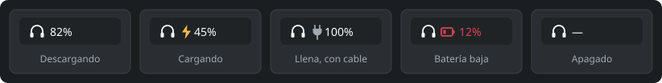
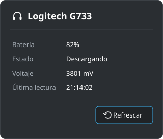

# Batería G733 para KDE Plasma

Widget para el panel de KDE Plasma 6 que muestra en todo momento el porcentaje de batería del headset inalámbrico **Logitech G733**.


## Tabla de contenidos

- [Descripción](#descripción)
- [Características](#características)
- [Stack tecnológico](#stack-tecnológico)
- [Requisitos](#requisitos)
- [Instalación](#instalación)
- [Uso](#uso)
- [Cómo funciona](#cómo-funciona)
- [Estructura del proyecto](#estructura-del-proyecto)
- [Solución de problemas](#solución-de-problemas)
- [Desinstalación](#desinstalación)
- [Créditos](#créditos)
- [Licencia](#licencia)

## Descripción

> **Proyecto personal.** Hice este widget para mi propio equipo: CachyOS con KDE Plasma 6 (Wayland) y mi headset **Logitech G733**. Solo lo he probado en ese entorno y con ese periférico. Para mi mouse, el Ajazz AJ159, hice otro widget aparte: [aj159-battery-plasmoid](https://github.com/Rafael-Ibarra-Beltran/aj159-battery-plasmoid).

Logitech solo ofrece G HUB, su software para ver la batería del G733, en Windows y macOS. En Linux no hay una forma integrada de saber cuánta batería le queda al headset.

Este proyecto añade un widget (plasmoide) al panel de KDE Plasma que lee el estado de la batería directamente del receptor USB inalámbrico y lo muestra junto a la bandeja del sistema. El widget no depende de servicios en segundo plano ni de programas externos.

## Características

- **Porcentaje siempre visible** en el panel, sin pasar el cursor por encima.
- **Estado de carga:** ⚡ mientras carga y 🔌 cuando el cable está conectado pero ya no carga (batería llena).
- **Aviso de batería baja:** por debajo del 15 % aparecen un ícono rojo y el número en rojo, sin ventanas emergentes.
- **Porcentaje igual al de G HUB**, calculado con la curva de batería del G733 que usa G HUB.
- **Panel de detalle** al hacer clic, con el estado, el voltaje, la hora de la última lectura y un botón **Refrescar**.
- **Lectura cada 60 segundos.**
- **Sin dependencias:** solo QML de Plasma y Python 3 con su biblioteca estándar.





## Stack tecnológico

| Componente | Tecnología |
|------------|------------|
| Interfaz | QML · Plasma 6 (`org.kde.plasma.plasmoid`) · Kirigami · Plasma Components 3 |
| Ejecución del lector | `org.kde.plasma.plasma5support` (DataSource `executable`) |
| Lector de batería | Python 3, solo biblioteca estándar · HID++ sobre `/dev/hidraw*` |
| Permisos | Regla udev con `TAG+="uaccess"` |
| Empaquetado | `kpackagetool6` (KPackage `Plasma/Applet`) |

## Requisitos

- KDE Plasma 6.
- Python 3.
- Headset Logitech G733 con su receptor USB (`046d:0afe`; también reconoce `046d:0ab5` y `046d:0b1f`).

## Instalación

1. Clona el repositorio:

   ```sh
   git clone https://github.com/Rafael-Ibarra-Beltran/g733-battery-plasmoid.git
   cd g733-battery-plasmoid
   ```

2. Instala la regla udev para que tu usuario pueda leer el receptor sin `sudo` (solo una vez):

   ```sh
   sudo install -m644 udev/70-g733-battery.rules /etc/udev/rules.d/
   sudo udevadm control --reload
   sudo udevadm trigger
   ```

3. Comprueba que el lector funciona:

   ```sh
   python3 package/contents/code/g733-battery
   ```

   Debe imprimir algo como:

   ```json
   {"status": "ok", "state": "discharging", "voltage_mv": 3801, "battery": 82, "cable": false, "error": null}
   ```

4. Instala el widget:

   ```sh
   ./install.sh
   ```

5. Haz clic derecho en el panel, elige **Añadir widgets…**, busca **Batería G733** y arrástralo junto a la bandeja del sistema.

Para actualizar a una versión nueva, ejecuta `./install.sh` otra vez y reinicia Plasma:

```sh
systemctl --user restart plasma-plasmashell
```

## Uso

| Panel | Significado |
|-------|-------------|
| `82%` | Descargando (en uso) |
| `⚡45%` | Cargando |
| `🔌100%` | Cable conectado, batería llena |
| `🔌 —` | Cable conectado, headset apagado |
| ícono rojo + `12%` | Batería baja (menos del 15 %) |
| `—` | Headset apagado, fuera de alcance o receptor desconectado |

Al hacer clic en el widget se abre el panel de detalle. **Refrescar** hace una lectura inmediata.

Al conectar el cable con la batería ya llena, el headset carga un par de minutos (⚡) antes de volver a decir que está lleno (🔌100%). Es el comportamiento normal del headset.

## Cómo funciona

```
main.qml ──(cada 60 s)──▶ g733-battery (Python) ──▶ /dev/hidrawN (receptor) ──▶ headset
    ▲                            │
    └──────────── JSON ◀─────────┘
```

1. El widget ejecuta `package/contents/code/g733-battery`.
2. El script busca en `/sys/class/hidraw` la interfaz del receptor que habla HID++ (Usage Page `0xff43`).
3. Envía la petición de batería, interpreta la respuesta e imprime una línea JSON.
4. El widget muestra el resultado.

El cable de carga se detecta porque, mientras está conectado, aparece el dispositivo USB `046d:0aff` ("G733 Gaming Headset Battery Charger").

### Protocolo

Se envía al receptor el reporte HID++ largo `11 ff 08 0a` seguido de 16 bytes en cero. La respuesta tiene esta forma:

| Byte | Significado |
|------|-------------|
| `d[2]` | `0x08`; `0xff` = headset apagado o fuera de alcance |
| `d[4..5]` | Voltaje de la batería en mV (big-endian) |
| `d[6]` | `1` descargando, `3` cargando, `7` llena |

### Estimación del porcentaje

El headset no informa un porcentaje: solo el voltaje y si está descargando, cargando o lleno. El porcentaje se estima así:

- **Llena:** 100 %.
- **Descargando:** curva de descarga del G733 que usa G HUB, tomada de su archivo `battery_0afe.xml` (en `C:\ProgramData\LGHUB\depots\<n>\g733_0afe\`). Esa curva relaciona el voltaje con la energía descargada (3122 mWh en total), y el porcentaje es la energía que queda. Comparado con G HUB: 3766 mV → 49 %, y G HUB marcó 51 %.
- **Cargando:** se muestra la última lectura hasta que el headset informa "llena". Mientras carga, el voltaje se queda casi fijo en ~3.99 V entre el 7 % y el 100 % (según la curva de carga del mismo archivo), así que no indica cuánto lleva.

La última lectura se guarda en `~/.local/state/g733-battery/state.json`.

> **¿Por qué no HeadsetControl?** Con el G733, [HeadsetControl](https://github.com/Sapd/HeadsetControl) solo reconoce el estado "cargando": una batería llena aparece igual que una que se descarga. Además usa una curva de voltaje genérica que muestra alrededor de un 68 % con el headset lleno.

## Estructura del proyecto

```
g733-battery-plasmoid/
├── package/
│   ├── metadata.json            # Metadatos del plasmoide
│   └── contents/
│       ├── code/g733-battery    # Lector de batería (Python)
│       └── ui/main.qml          # Interfaz del widget
├── udev/70-g733-battery.rules   # Permiso de acceso al receptor
├── docs/images/                 # Imágenes del README
├── install.sh                   # Instala o actualiza el widget
└── LICENSE
```

## Solución de problemas

| Síntoma | Solución |
|---------|----------|
| "Sin permiso: instala la regla udev" | Instala la regla (paso 2 de la instalación) y desconecta y vuelve a conectar el receptor. |
| "Receptor no encontrado" | Comprueba que el receptor está conectado: `lsusb \| grep 046d:0afe`. |
| `—` con el headset encendido | Acércalo al receptor y pulsa **Refrescar**. |
| El widget no se actualiza tras `./install.sh` | Reinicia Plasma: `systemctl --user restart plasma-plasmashell`. |
| El porcentaje no coincide con G HUB | Puede haber 1-2 puntos de diferencia por el ruido del voltaje. Mientras carga, el widget muestra la última lectura y no el avance de la carga. |

Para depurar, `python3 package/contents/code/g733-battery --raw` imprime además en stderr los bytes de la respuesta.

## Desinstalación

```sh
kpackagetool6 -t Plasma/Applet --remove g733-battery
sudo rm /etc/udev/rules.d/70-g733-battery.rules
rm -r ~/.local/state/g733-battery
```

## Créditos

- [g933-utils](https://github.com/ashkitten/g933-utils) (MIT, Copyright (c) 2019 ash lea): significado de los estados de batería y curvas de voltaje medidas.
- Logitech G HUB: los puntos de la curva de descarga del G733 (`battery_0afe.xml`). El archivo no se incluye en este repositorio.
- [HeadsetControl](https://github.com/Sapd/HeadsetControl): referencia de la petición HID++ para la familia G633/G933/G733.

Logitech y G733 son marcas de Logitech. Este proyecto no está afiliado a Logitech.

## Licencia

Distribuido bajo la licencia MIT. Consulta [LICENSE](LICENSE).
